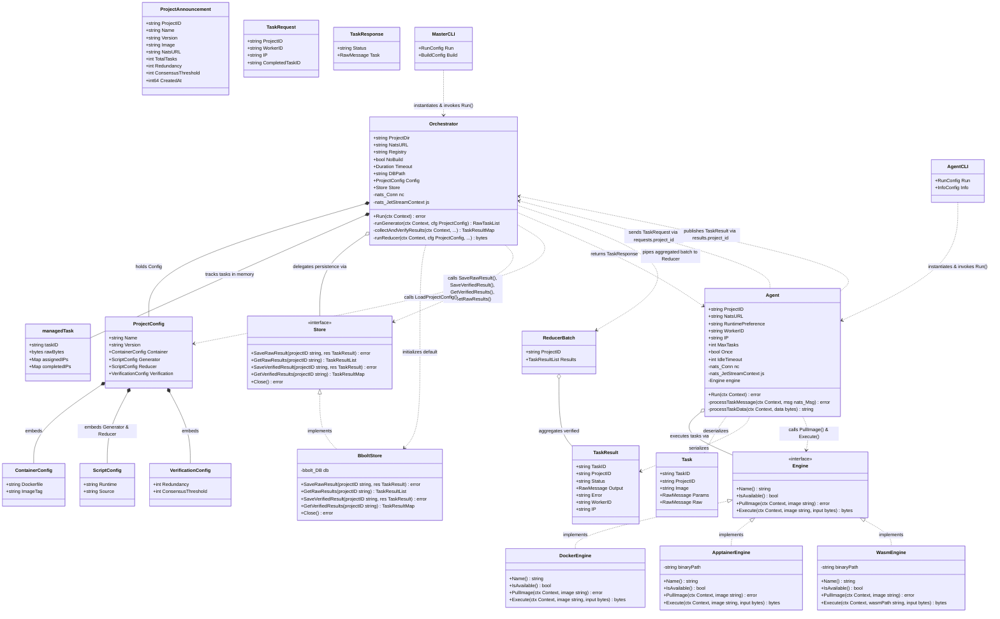
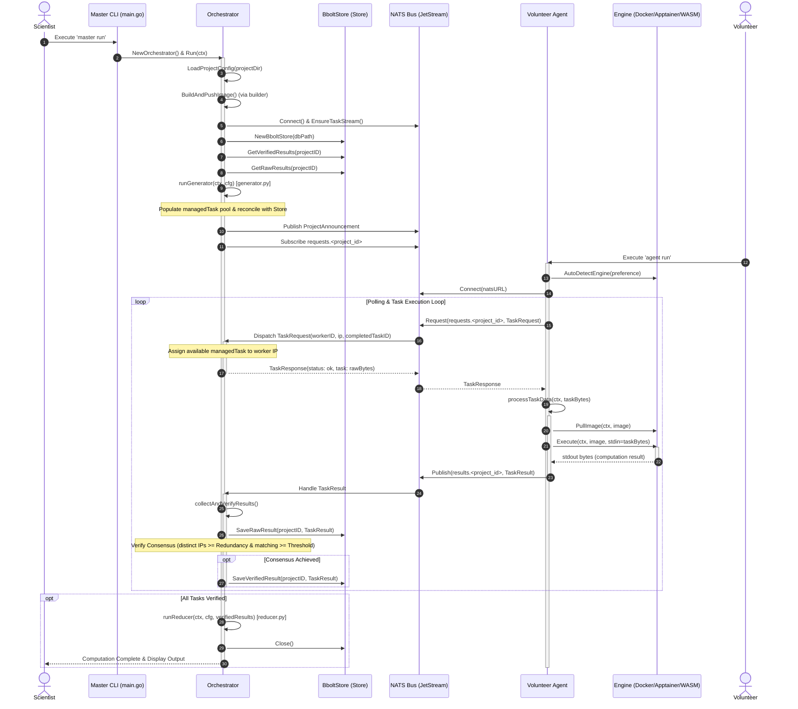

# speedboat

A modern hpc volunteer computing way using go.

## System Architecture & UML Diagrams

This document outlines the struct design, interface implementations, relationships, and method call interactions across the Speedboat platform based on the blueprint in [docs/project.txt](docs/project.txt).

Speedboat decouples scientific orchestrators (**Master Node**) from untrusted volunteer worker nodes (**Agent**) using **NATS** as the message bus and pluggable sandbox runtimes (**Docker**, **Apptainer**, and **WASM**).

---

### 1. Structural UML Diagram (Class Diagram)

The following UML Class Diagram models all Go structs and interfaces across the system, detailing their fields, method receivers, interface realizations (`..|>`), compositions (`*--`), aggregations (`o--`), and dependency associations (`..>`).

---

### 2. Method Call & Dynamic Interaction Flow

The following Sequence Diagram shows how methods across the structs invoke each other during the execution lifecycle—from project initialization and task generation to agent execution, consensus verification, and reduction.

---

### 3. Struct Reference & Responsibilities

| Struct / Interface | Package | Key Responsibilities | Relationships & Method Invocations |
| :--- | :--- | :--- | :--- |
| [`Orchestrator`](internal/orchestrator/orchestrator.go#L30-L41) | `internal/orchestrator` | Central master orchestrator. Loads configs, builds images, generates tasks, distributes work, validates consensus, and triggers reduction. | • Owns [`ProjectConfig`](internal/protocol/types.go#L12-L19) • Owns in-memory [`managedTask`](internal/orchestrator/orchestrator.go#L23-L28) pool • Uses [`Store`](internal/store/store.go#L8-L23) (`SaveRawResult`, `SaveVerifiedResult`) • Calls internal `runGenerator`, `collectAndVerifyResults`, `runReducer` |
| [`managedTask`](internal/orchestrator/orchestrator.go#L23-L28) | `internal/orchestrator` | Internal tracking entity for a single task unit, tracking active IP leases and completions. | • Managed exclusively by [`Orchestrator`](internal/orchestrator/orchestrator.go#L30-L41) to enforce redundancy limits and avoid duplicate IP assignment |
| [`Agent`](internal/agent/agent.go#L19-L32) | `internal/agent` | Volunteer client worker. Polls for tasks, executes tasks in a sandbox, and reports results. | • Holds and delegates execution to [`Engine`](internal/runtime/engine.go#L9-L14) • Calls `processTaskData` to parse [`Task`](internal/protocol/types.go#L36-L42) and publish [`TaskResult`](internal/protocol/types.go#L44-L52) |
| [`Engine`](internal/runtime/engine.go#L9-L14) *(Interface)* | `internal/runtime` | Abstraction for isolated execution runtimes (`PullImage`, `Execute`, `IsAvailable`, `Name`). | • Implemented by [`DockerEngine`](internal/runtime/docker.go#L12), [`ApptainerEngine`](internal/runtime/apptainer.go#L11-L13), and [`WasmEngine`](internal/runtime/wasm.go#L11-L13) • Invoked by [`Agent.processTaskData`](internal/agent/agent.go#L194-L273) |
| [`DockerEngine`](internal/runtime/docker.go#L12) | `internal/runtime` | Executes tasks inside rootless Docker containers with `--network none` isolation. | • Implements [`Engine`](internal/runtime/engine.go#L9-L14) |
| [`ApptainerEngine`](internal/runtime/apptainer.go#L11-L13) | `internal/runtime` | Executes tasks inside Apptainer/Singularity HPC containers with network isolation. | • Implements [`Engine`](internal/runtime/engine.go#L9-L14) |
| [`WasmEngine`](internal/runtime/wasm.go#L11-L13) | `internal/runtime` | Executes `.wasm` payloads using `wasmtime`, `wasmer`, or `wazero` pure-Go runtime. | • Implements [`Engine`](internal/runtime/engine.go#L9-L14) |
| [`Store`](internal/store/store.go#L8-L23) *(Interface)* | `internal/store` | Persistence contract for master state recovery (raw worker outputs and verified results). | • Implemented by [`BboltStore`](internal/store/bbolt.go#L21-L23) • Invoked by [`Orchestrator`](internal/orchestrator/orchestrator.go#L30-L41) during startup and verification |
| [`BboltStore`](internal/store/bbolt.go#L21-L23) | `internal/store` | Embedded ACID key-value store implementation using BBolt. | • Implements [`Store`](internal/store/store.go#L8-L23) |
| [`ProjectConfig`](internal/protocol/types.go#L12-L19) | `internal/protocol` | Unmarshaled configuration parsed from `project.yaml`. | • Embeds [`ContainerConfig`](internal/protocol/types.go#L21-L24), [`ScriptConfig`](internal/protocol/types.go#L26-L29), [`VerificationConfig`](internal/protocol/types.go#L31-L34) |
| [`Task`](internal/protocol/types.go#L36-L42) | `internal/protocol` | Unit of scientific computation containing parameters and target container image. | • Generated by generator script, wrapped by master, processed by agent |
| [`TaskResult`](internal/protocol/types.go#L44-L52) | `internal/protocol` | Computation output or error emitted by a worker node for a given task. | • Published by agent to `results.<project_id>`, ingested and persisted by master |
| [`TaskRequest`](internal/protocol/types.go#L71-L76) / [`TaskResponse`](internal/protocol/types.go#L78-L81) | `internal/protocol` | Request-reply payload for work pulling and lease tracking over NATS. | • Exchanged between [`Agent`](internal/agent/agent.go#L19-L32) and [`Orchestrator`](internal/orchestrator/orchestrator.go#L30-L41) on `requests.<project_id>` |
| [`ReducerBatch`](internal/protocol/types.go#L66-L69) | `internal/protocol` | Aggregated slice of consensus-verified results passed to `reducer.py`. | • Constructed by [`Orchestrator.runReducer`](internal/orchestrator/orchestrator.go#L550-L596) |
| [`ProjectAnnouncement`](internal/protocol/types.go#L54-L64) | `internal/protocol` | Broadcast message announcing project availability and metadata. | • Published by [`Orchestrator`](internal/orchestrator/orchestrator.go#L30-L41) on `announcements` and `projects.<id>.info` |
| `CLI` (Master) | `cmd/master` | Command-line interface for the scientist to run the master orchestrator. | • Instantiates and runs [`Orchestrator`](internal/orchestrator/orchestrator.go#L30-L41) |
| `CLI` (Agent) | `cmd/agent` | Command-line interface for volunteers running the compute agent. | • Instantiates and runs [`Agent`](internal/agent/agent.go#L19-L32) |

